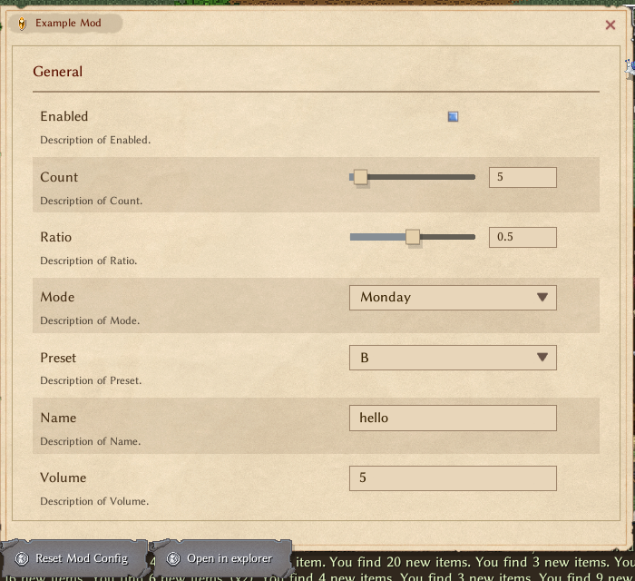

# Mod Config

Every mod can have its own config page, opened from its row in the mod viewer. A BepInEx plugin gets one generated from its `Config.Bind` entries. To lay the page out yourself, implement `IModConfig`.


The generated page:



## Your own layout: `IModConfig`

A plugin that implements `IModConfig` gets no generated page and builds the whole page in `OnBuildConfig`:

| Extension (`using EModding;`) | What you get |
|-|-|
| `note.AddAll(Config)` | the whole generated page, sections included |
| `note.Add(entry)` | one row: label, a widget chosen by the entry type, the description and a reset button |
| `note.AddSlider(entry, min, max, label = null)` | a row with a slider over `min`..`max`, whatever range the entry declares; returns its `Slider` |
| `note.AddDropdown(entry, values, label = null)` | a row with a dropdown over `values`, for any entry type; returns its `UIDropdown`, which is already bound to the entry, so do not call `SetList` on it (use `note.AddDropdown(label)` for a list of your own) |

All of them read and write the entry directly. Section names, labels (the entry `Key`), descriptions and dropdown choices are looked up with `Lang.Get`, using the string itself as the id. Without a matching row, keys, section names and choices are split into words (`ProtectionWeight` is shown as `Protection Weight`) and descriptions are shown as written. To translate them, add rows with those strings as ids to the `General` sheet in your mod's `LangMod` folder (see [Basic Elin Sheet Modding and You](../2_Getting%20Started/sourcesheet_setup.md)):

| id | filter | text_JP | text |
|-|-|-|-|
| ProtectionWeight | | 防御の重み | Protection weight |
| Score per point of PV. | | PV 1 点あたりのスコア | Score per point of PV. |

Changes are written to the entry as soon as the player makes them. If your plugin reads an entry only in `Awake`, the change takes effect after a restart, so say so in the description; to apply it at once, subscribe to the entry's `SettingChanged`. The page is rebuilt each time it opens, so do not keep references to its widgets. Keep state that is not a `ConfigEntry` in your own fields and read or write it in the callbacks.

```cs
using System.Collections.Generic;
using BepInEx;
using BepInEx.Configuration;
using EModding;

[BepInPlugin("author.example", "Example", "1.0.0")]
public class ExamplePlugin : BaseUnityPlugin, IModConfig {
	public ConfigEntry<bool> enabled;
	public ConfigEntry<int> count;
	public ConfigEntry<string> preset;
	public string mode = "B", name = "hello";

	void Awake() {
		enabled = Config.Bind("General", "Enabled", true);
		count = Config.Bind("General", "Count", 5);
		preset = Config.Bind("General", "Preset", "b");
	}

	public void OnBuildConfig(UINote note) {
		note.AddHeader("General");
		note.Add(enabled);                                   // toggle
		note.AddSlider(count, 0, 100, "How many");           // slider, no AcceptableValueRange needed
		note.AddDropdown(preset, ["a", "b", "c"]); // fixed choices

		note.AddHeader("Advanced");

		// values that are not a ConfigEntry use the plain UINote methods
		var modes = ["A", "B", "C"];
		var dd = note.AddDropdown("Mode");
		dd.SetList(modes.IndexOf(mode), modes, (m, i) => m, (i, m) => mode = m, false);
		note.AddText("Which mode to use.", FontColor.Passive);

		UIButton b = null;
		b = note.AddButton("Name: " + name, () => Dialog.InputName("Name", name, (cancel, text) => {
			if (cancel) return;
			name = text;
			b.mainText.text = "Name: " + text;
		}, Dialog.InputType.Chat));

		note.AddTopic("Version", Info.Metadata.Version.ToString());
		note.AddButtonLink("Project page", "https://example.com/");
	}
}
```

To keep the generated page and add to it, call `note.AddAll(Config);` first.


To reset your own state with the reset button, add a delegate to the package's `onResetConfig`. Every entry in `Config` is already reset, so handle only your own state:

```cs
void Start() {
	var pkg = ModUtil.FindFileProviderPackage(new FileInfo(Info.Location));
	if (pkg != null) {
        pkg.onResetConfig += () => mode = "B";
    }
}
```

## `UINote` cheat sheet

| Method | What you get |
|-|-|
| `AddHeader(string)` / `AddHeaderTopic(string)` | section header (the one the generated page uses) / small heading |
| `AddToggle(string label, bool isOn, Action<bool>)` | toggle; returns `UIButton` |
| `AddSlider(float value, Func<float,string> action, float min = 0, float max = 1, bool isInt = false)` | slider; `action` receives the value and returns the label text; returns `Slider` |
| `AddDropdown(string label)` | label and dropdown; returns `UIDropdown`, filled with `SetList(index, list, getName, onChange, notify: false)` |
| `AddButton(string text, Action)` | full-width button; returns `UIButton` |
| `AddText(string)` / `AddText(string, FontColor.Passive)` | body text that wraps |
| `AddTopic(string label, string value)` | label on the left, value on the right |
| `AddButtonLink(string text, string url)` | link |
| `Space(int height)` | empty row |
| `AddImage(Sprite)` / `AddPrefab(string path)` | image / your own prefab |
