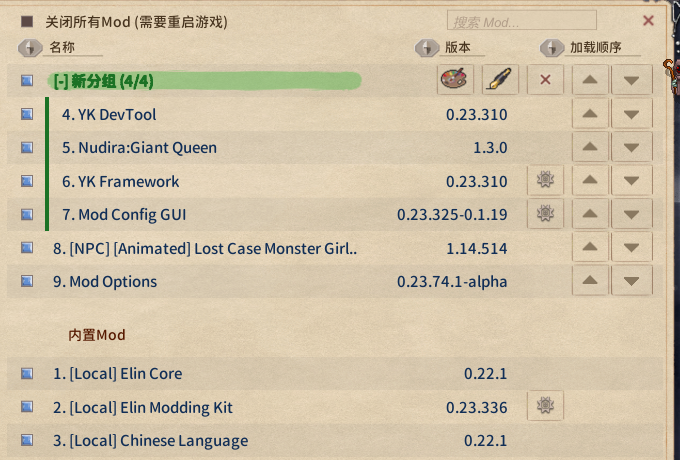
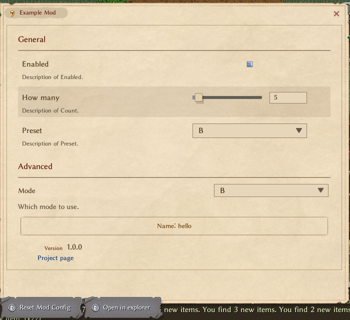

# Mod 配置页

每个 mod 都可以有自己的配置页，从 Mod 查看器里它那一行打开。BepInEx 插件会按 `Config.Bind` 过的条目自动生成页面；想自己排版就实现 `IModConfig`。



生成的页面：


## 自己排版：`IModConfig`

实现了 `IModConfig` 的插件不会自动生成页面，整页都在 `OnBuildConfig` 里自己搭：

| 扩展（`using EModding;`） | 得到什么 |
|-|-|
| `note.AddAll(Config)` | 整个自动生成的页面，含分节 |
| `note.Add(entry)` | 一行：标签、按条目类型选的控件、说明、重置按钮 |
| `note.AddSlider(entry, min, max, label = null)` | 一行 `min`～`max` 的滑条，不用条目自己声明的区间；返回这一行的 `Slider` |
| `note.AddDropdown(entry, values, label = null)` | 一行以 `values` 为候选的下拉，任何条目类型都行；返回的 `UIDropdown` 已绑定到条目，不要再对它 `SetList`（自己的列表用 `note.AddDropdown(label)`） |

它们都直接读写条目。分节名、标签（条目的 `Key`）、说明、下拉选项都以字符串本身为 id，用 `Lang.Get` 查找译文。没有对应行时，`Key`、分节名、下拉选项会拆成单词显示（`ProtectionWeight` 显示为 `Protection Weight`），说明原样显示。要翻译，就在 mod 的 `LangMod` 文件夹里的 `General` 表中以这些字符串为 id 加行（见[新手指南：填表制作 Elin 模组](../2_Getting%20Started/sourcesheet_setup.md)）：

| id | filter | text_JP | text |
|-|-|-|-|
| ProtectionWeight | | 防御の重み | Protection weight |
| Score per point of PV. | | PV 1 点あたりのスコア | Score per point of PV. |

玩家一改，值就写进条目。只在 `Awake` 里读配置的插件要重启才生效，请在说明里写明；想即时生效，订阅条目的 `SettingChanged`。页面每次打开都会重建，不要保存控件引用；不是 `ConfigEntry` 的状态放在自己的字段里，在回调中读写。

```cs
using System.Collections.Generic;
using BepInEx;
using BepInEx.Configuration;
using EModding;

[BepInPlugin("author.example", "Example", "1.0.0")]
public class ExamplePlugin : BaseUnityPlugin, IModConfig {
	public ConfigEntry<bool> enabled;
	public ConfigEntry<int> count;
	public ConfigEntry<string> preset;
	public string mode = "B", name = "hello";

	void Awake() {
		enabled = Config.Bind("General", "Enabled", true);
		count = Config.Bind("General", "Count", 5);
		preset = Config.Bind("General", "Preset", "b");
	}

	public void OnBuildConfig(UINote note) {
		note.AddHeader("General");
		note.Add(enabled);                                   // 开关
		note.AddSlider(count, 0, 100, "How many");           // 滑条，不需要 AcceptableValueRange
		note.AddDropdown(preset, ["a", "b", "c"]); // 固定候选

		note.AddHeader("Advanced");

		// 不是 ConfigEntry 的值用普通的 UINote 方法
		var modes = ["A", "B", "C"];
		var dd = note.AddDropdown("Mode");
		dd.SetList(modes.IndexOf(mode), modes, (m, i) => m, (i, m) => mode = m, false);
		note.AddText("Which mode to use.", FontColor.Passive);

		UIButton b = null;
		b = note.AddButton("Name: " + name, () => Dialog.InputName("Name", name, (cancel, text) => {
			if (cancel) return;
			name = text;
			b.mainText.text = "Name: " + text;
		}, Dialog.InputType.Chat));

		note.AddTopic("Version", Info.Metadata.Version.ToString());
		note.AddButtonLink("Project page", "https://example.com/");
	}
}
```

要保留自动页面再加几项，先调用 `note.AddAll(Config);`，再往后加。



想让重置按钮也重置你自己的状态，就往包的 `onResetConfig` 上追加委托。`Config` 里的条目会自动重置，这里只需处理自己的部分：

```cs
void Start() {
	var pkg = ModUtil.FindFileProviderPackage(new FileInfo(Info.Location));
	if (pkg != null) {
        pkg.onResetConfig += () => mode = "B";
    }
}
```

## `UINote` 速查

| 方法 | 得到什么 |
|-|-|
| `AddHeader(string)` / `AddHeaderTopic(string)` | 分节标题（自动页面用的就是它）/ 小标题 |
| `AddToggle(string label, bool isOn, Action<bool>)` | 开关，返回 `UIButton` |
| `AddSlider(float value, Func<float,string> action, float min = 0, float max = 1, bool isInt = false)` | 滑条，`action` 接收值并返回标签文字，返回 `Slider` |
| `AddDropdown(string label)` | 标签加下拉，返回 `UIDropdown`，用 `SetList(index, list, getName, onChange, notify: false)` 填 |
| `AddButton(string text, Action)` | 整行按钮，返回 `UIButton` |
| `AddText(string)` / `AddText(string, FontColor.Passive)` | 正文，自动换行 |
| `AddTopic(string label, string value)` | 左标签右值 |
| `AddButtonLink(string text, string url)` | 链接 |
| `Space(int height)` | 空行 |
| `AddImage(Sprite)` / `AddPrefab(string path)` | 图片 / 自带 prefab |
